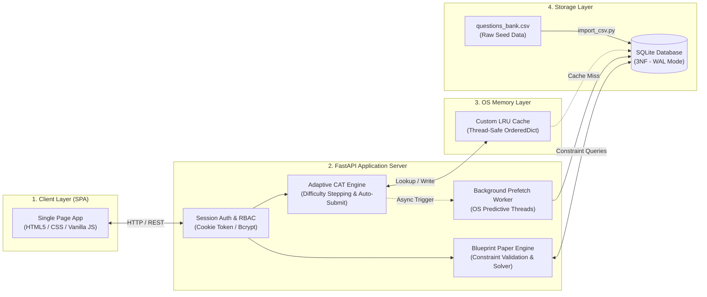
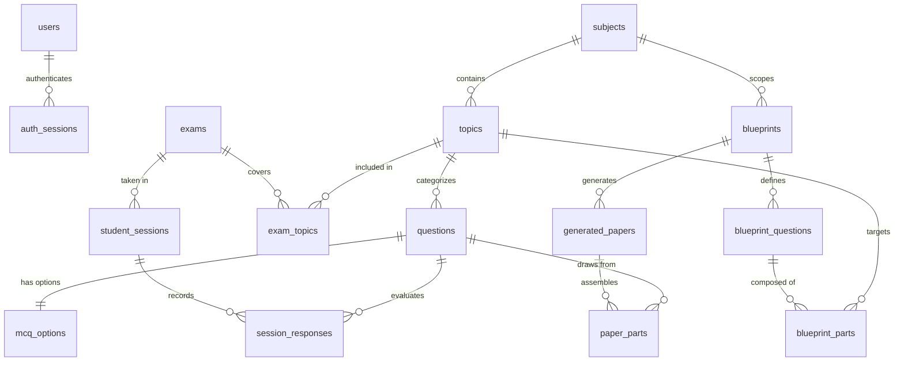
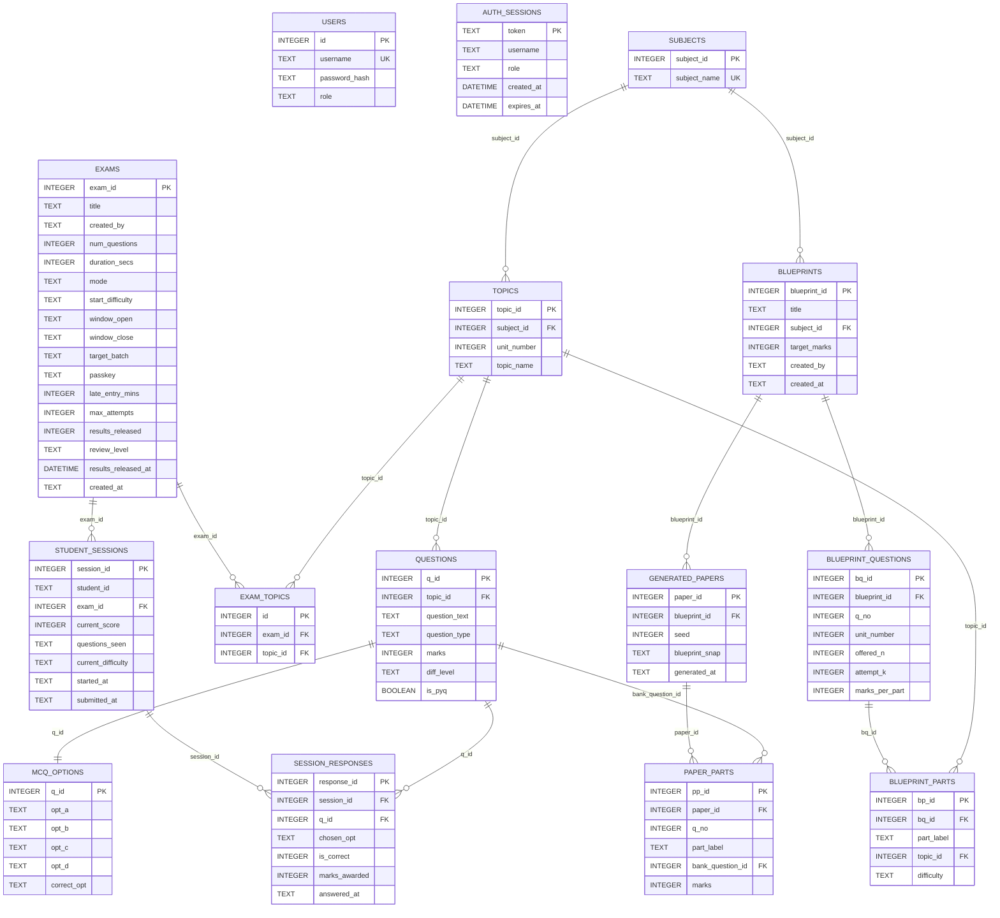

# Adaptive Paper Engine for eXaminations (APEX)

An OS-Optimized Institutional Assessment and Dynamic Question Bank Generator. This is a combined Project-Based Learning (PBL) project integrating **Operating Systems (OS)** concurrency concepts and **Database Management Systems (DBMS)** 3NF relational design.

---

## 📌 Project Overview

Traditional examination workflows suffer from two major challenges:
1. **Static Assessments:** Fixed-question tests fail to adjust to an individual student's mastery level in real time.
2. **Manual Paper Setting:** Teachers face significant manual overhead balancing syllabus units, difficulty distributions, and part options when generating offline exam papers.

**APEX** addresses these challenges via a unified dual-engine architecture:
- **Live Adaptive Testing Engine (Computer-Adaptive Testing - CAT):** Leverages an in-memory LRU cache and predictive prefetching to deliver real-time, difficulty-adjusting questions with sub-second latency. Includes exam window scheduling, room PIN/passkey security, late entry cutoffs, and single-attempt enforcement.
- **Offline Exam Paper Generator:** Uses a constraint-satisfaction algorithm with backtracking and random seeding to instantly assemble multi-part university question papers from a normalized question bank.

---

## 🏛️ System Architecture



---

## 🗄️ Database Architecture & Relational Schema

APEX utilizes an SQLite database configured in **WAL (Write-Ahead Logging) mode** with foreign key constraints enabled for high-concurrency read/write operations during live tests.

### 1. High-Level Entity-Relationship Model (ERD)



---

### 2. Comprehensive Relational Schema Diagram (Tables, Columns & Keys)

The diagram below provides a complete overview of all tables, columns, primary keys (`PK`), foreign keys (`FK`), and inter-table relationships:



---

### 3. Detailed Schema Tables Breakdown

#### 🔐 Domain A: Authentication & Access Control
| Table | Column Name | Data Type | Constraint | Description |
|---|---|---|---|---|
| **`users`** | `id` | INTEGER | PRIMARY KEY AUTOINCREMENT | Unique user identifier |
| | `username` | TEXT | UNIQUE NOT NULL | User login identifier |
| | `password_hash` | TEXT | NOT NULL | Salted bcrypt hash |
| | `role` | TEXT | NOT NULL CHECK (in `'student'`, `'teacher'`, `'admin'`) | Access role |
| **`auth_sessions`** | `token` | TEXT | PRIMARY KEY | Random 64-char secure token |
| | `username` | TEXT | NOT NULL | User associated with token |
| | `role` | TEXT | NOT NULL | Cached user role |
| | `created_at` | DATETIME | DEFAULT CURRENT_TIMESTAMP | Login timestamp |
| | `expires_at` | DATETIME | NOT NULL | Session expiry boundary |

---

#### 📚 Domain B: Question Bank & Curriculum (3NF)
| Table | Column Name | Data Type | Constraint | Description |
|---|---|---|---|---|
| **`subjects`** | `subject_id` | INTEGER | PRIMARY KEY AUTOINCREMENT | Course identifier |
| | `subject_name` | TEXT | UNIQUE NOT NULL | Course display name |
| **`topics`** | `topic_id` | INTEGER | PRIMARY KEY AUTOINCREMENT | Topic identifier |
| | `subject_id` | INTEGER | FOREIGN KEY -> `subjects(subject_id)` | Parent subject |
| | `unit_number` | INTEGER | NOT NULL | Syllabus unit number (1 to 5) |
| | `topic_name` | TEXT | NOT NULL | Topic description |
| **`questions`** | `q_id` | INTEGER | PRIMARY KEY AUTOINCREMENT | Question bank identifier |
| | `topic_id` | INTEGER | FOREIGN KEY -> `topics(topic_id)` | Associated topic |
| | `question_text`| TEXT | NOT NULL | Full question text/prompt |
| | `question_type`| TEXT | NOT NULL | `'MCQ'` or `'Subjective'` |
| | `marks` | INTEGER | NOT NULL | Weightage (e.g. 1, 2, 5, 10) |
| | `diff_level` | TEXT | NOT NULL (`'Easy'`, `'Medium'`, `'Hard'`) | Calibrated difficulty |
| | `is_pyq` | BOOLEAN | DEFAULT 0 | Previous Year Question flag |
| *(Index)* | `idx_diff_topic`| INDEX | ON `questions(diff_level, topic_id)` | High-speed matching |
| **`mcq_options`** | `q_id` | INTEGER | PRIMARY KEY, FK -> `questions(q_id)` | 1-to-1 option mapping |
| | `opt_a` / `opt_b` / `opt_c` / `opt_d` | TEXT | NULLABLE | Multiple choice option texts |
| | `correct_opt` | TEXT | NULLABLE (Never exposed to student API) | Answer key (`A`, `B`, `C`, `D`) |

---

#### ⏱️ Domain C: Online Adaptive Testing (CAT)
| Table | Column Name | Data Type | Constraint | Description |
|---|---|---|---|---|
| **`exams`** | `exam_id` | INTEGER | PRIMARY KEY AUTOINCREMENT | Exam identifier |
| | `title` | TEXT | NOT NULL | Exam name |
| | `created_by` | TEXT | NOT NULL DEFAULT 'teacher' | Author username |
| | `num_questions`| INTEGER | NOT NULL DEFAULT 20 | Exam total question count |
| | `duration_secs`| INTEGER | NOT NULL DEFAULT 1800 | Exam timer limit in seconds |
| | `mode` | TEXT | NOT NULL DEFAULT 'adaptive' | `'adaptive'` or `'fixed'` |
| | `start_difficulty`| TEXT | DEFAULT 'Medium' | Initial question difficulty |
| | `window_open` / `window_close` | TEXT | ISO Timestamp strings | Allowed examination window |
| | `target_batch` | TEXT | DEFAULT 'All' | Candidate batch filter |
| | `passkey` | TEXT | NULLABLE | Room PIN / Secret Passkey |
| | `late_entry_mins`| INTEGER | DEFAULT 15 | Late admission window limit |
| | `max_attempts` | INTEGER | DEFAULT 1 | Attempt cap per student |
| | `results_released`| INTEGER | DEFAULT 0 | Visibility status (0=Locked, 1=Released) |
| | `review_level` | TEXT | DEFAULT 'score_and_correctness' | Results granularity control |
| **`exam_topics`** | `id` | INTEGER | PRIMARY KEY AUTOINCREMENT | Junction entry identifier |
| | `exam_id` | INTEGER | FK -> `exams(exam_id)` | Selected exam |
| | `topic_id` | INTEGER | FK -> `topics(topic_id)` | Included topic (`UNIQUE(exam_id, topic_id)`) |
| **`student_sessions`** | `session_id` | INTEGER | PRIMARY KEY AUTOINCREMENT | Live test attempt record |
| | `student_id` | TEXT | NOT NULL | Candidate username |
| | `exam_id` | INTEGER | FK -> `exams(exam_id)` | Target exam |
| | `current_score`| INTEGER | DEFAULT 0 | Running score |
| | `questions_seen`| TEXT | DEFAULT '' | Comma-delimited list of served `q_id`s |
| | `current_difficulty`| TEXT| DEFAULT 'Medium' | Dynamic difficulty state |
| | `started_at` | TEXT | ISO Timestamp | Start timestamp |
| | `submitted_at` | TEXT | ISO Timestamp | Completion timestamp |
| **`session_responses`**| `response_id` | INTEGER | PRIMARY KEY AUTOINCREMENT | Individual answer log |
| | `session_id` | INTEGER | FK -> `student_sessions(session_id)` | Associated session |
| | `q_id` | INTEGER | FK -> `questions(q_id)` | Question answered |
| | `chosen_opt` | TEXT | NOT NULL | Selected choice (`A`, `B`, `C`, `D`) |
| | `is_correct` | INTEGER | NOT NULL (0 or 1) | Automatic grading flag |
| | `marks_awarded`| INTEGER | NOT NULL | Points credited |
| | `answered_at` | TEXT | DEFAULT `(datetime('now'))` | Submission timestamp |
| *(Constraint)* | `UNIQUE` | | `UNIQUE(session_id, q_id)` | Prevents duplicate answers |

---

#### 📝 Domain D: Written Blueprint & Generation Engine
| Table | Column Name | Data Type | Constraint | Description |
|---|---|---|---|---|
| **`blueprints`** | `blueprint_id` | INTEGER | PRIMARY KEY AUTOINCREMENT | Template identifier |
| | `title` | TEXT | NOT NULL | Blueprint title (e.g., *Mid-Sem Exam*) |
| | `subject_id` | INTEGER | FK -> `subjects(subject_id)` | Target subject |
| | `target_marks` | INTEGER | NULLABLE | Enforced total marks limit |
| | `created_by` | TEXT | NOT NULL | Teacher author |
| | `created_at` | TEXT | DEFAULT `(datetime('now'))` | Creation timestamp |
| **`blueprint_questions`** | `bq_id` | INTEGER | PRIMARY KEY AUTOINCREMENT | Main question slot |
| | `blueprint_id`| INTEGER | FK -> `blueprints(blueprint_id)` | Parent blueprint |
| | `q_no` | INTEGER | NOT NULL | Question number (1, 2, 3...) |
| | `unit_number` | INTEGER | NOT NULL | Syllabus unit restriction |
| | `offered_n` | INTEGER | CHECK (`offered_n >= 1`) | Total sub-parts given |
| | `attempt_k` | INTEGER | CHECK (`attempt_k <= offered_n`) | Sub-parts student must answer |
| | `marks_per_part`| INTEGER| CHECK (`marks_per_part >= 1`) | Marks per attempted part |
| **`blueprint_parts`** | `bp_id` | INTEGER | PRIMARY KEY AUTOINCREMENT | Part specification |
| | `bq_id` | INTEGER | FK -> `blueprint_questions(bq_id)` | Parent question slot |
| | `part_label` | TEXT | NOT NULL | Label (`a`, `b`, `c`, `d`) |
| | `topic_id` | INTEGER | NULLABLE (FK -> `topics(topic_id)`) | Specific topic (or NULL for any in unit) |
| | `difficulty` | TEXT | NOT NULL (`'Easy'`, `'Medium'`, `'Hard'`) | Part difficulty |
| **`generated_papers`** | `paper_id` | INTEGER | PRIMARY KEY AUTOINCREMENT | Generated paper instance |
| | `blueprint_id`| INTEGER | FK -> `blueprints(blueprint_id)` | Source template |
| | `seed` | INTEGER | NOT NULL | Random seed for exact reproducibility |
| | `blueprint_snap`| TEXT | NOT NULL (JSON) | Blueprint configuration snapshot |
| | `generated_at`| TEXT | DEFAULT `(datetime('now'))` | Generation timestamp |
| **`paper_parts`** | `pp_id` | INTEGER | PRIMARY KEY AUTOINCREMENT | Generated question part map |
| | `paper_id` | INTEGER | FK -> `generated_papers(paper_id)` | Generated paper instance |
| | `q_no` / `part_label` | INTEGER / TEXT | NOT NULL | Slot label mapping |
| | `bank_question_id`| INTEGER | FK -> `questions(q_id)` | Drawn bank question |
| | `marks` | INTEGER | NOT NULL | Allocated marks |

---

## ⚡ Core OS & DBMS Implementations

| Concept | Implementation Details in APEX |
|---|---|
| **Memory Caching (OS)** | Custom thread-safe `LRUCache` (`src/cache.py`) replaces heavy external brokers like Redis for fast question lookup. |
| **Predictive Prefetching (OS)** | Background worker threads pre-compute prospective Easy/Medium/Hard branches ahead of the student's submission. |
| **Concurrency Control (DBMS)** | SQLite enabled with **WAL mode**, `busy_timeout=5000ms`, and short transactions to handle simultaneous student submissions. |
| **Idempotency & Integrity** | Unique composite constraints (`UNIQUE(session_id, q_id)`) guard against double submission and race conditions. |
| **Security & Auditing** | `correct_opt` is strictly stripped from all student payloads; teacher answer keys unlock only based on exam `review_level` and `results_released` state. |

---

## 📁 Project Structure

```text
APEX/
├── db/                   # questions_bank.csv raw seed dataset
├── frontend/             # Single-page client UI (HTML5, Vanilla CSS/JS)
│   ├── index.html        # Unified student & teacher application
│   ├── style.css         # Modern, responsive stylesheet
│   ├── ui-logic.js       # Dynamic client controller & session lifecycle
│   └── api.js            # Unified REST client module
├── scripts/
│   └── import_csv.py     # Data Ingestion & SQL Transaction script
├── src/
│   ├── main.py           # Core FastAPI Server & REST endpoints
│   ├── database.py       # SQLite connection (WAL mode) & schema migration
│   ├── cache.py          # LRU Memory Cache implementation
│   ├── paper_engine.py   # Constraint-based Blueprint question generator
│   └── blueprint.py      # University paper layout generator
├── tests/                # Unit & regression tests (cache, paper engine)
├── start.bat             # One-click launcher script
└── requirements.txt      # Core Python dependencies
```

---

## 🚀 Quickstart & Local Setup

### 1. Install Dependencies
```bash
pip install -r requirements.txt
```

### 2. Launch the Application
- **Windows (Recommended):** Double-click or run `start.bat`
- **Manual Launch:**
  ```bash
  python -m uvicorn src.main:app --host 127.0.0.1 --port 8000 --reload
  ```

### 3. Open in Browser
Visit: **[http://127.0.0.1:8000/ui](http://127.0.0.1:8000/ui)**

- **Teacher Credentials:** `teacher` / `pass123`
- **Student Credentials:** `student` / `pass123`

---

## 👥 Team Info

- **Team Lead:** Khushi Sharma
- **Team Members:** Roma Yadav, Rohit Sharma, Alok Goyal
