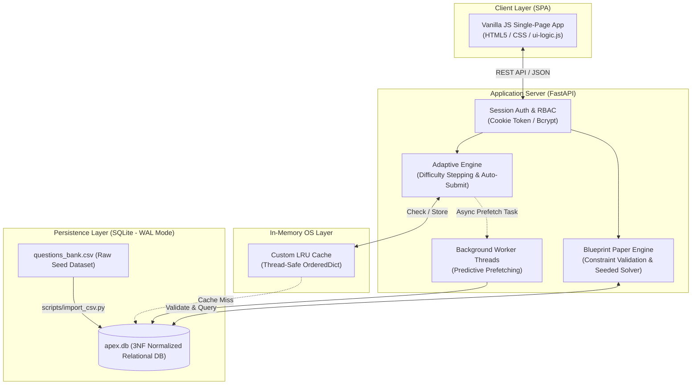
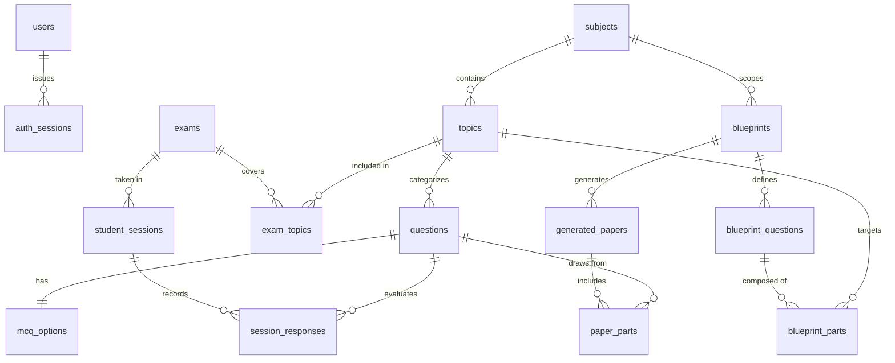

# Adaptive Paper Engine for eXaminations (APEX)

An OS-Optimized Institutional Assessment and Dynamic Question Bank Generator. This is a combined Project-Based Learning (PBL) project integrating **Operating Systems (OS)** concurrency concepts and **Database Management Systems (DBMS)** 3NF relational design.

---

## 📌 Project Overview

Traditional examination workflows suffer from two major challenges:
1. **Static Assessments:** Fixed-question tests fail to adjust to an individual student's mastery level in real time.
2. **Manual Paper Setting:** Teachers face significant manual overhead balancing syllabus units, difficulty distributions, and part options when generating offline exam papers.

**APEX** addresses these challenges via a unified dual-engine architecture:
- **Live Adaptive Testing Engine (Computer-Adaptive Testing - CAT):** Leverages an in-memory LRU cache and predictive prefetching to deliver real-time, difficulty-adjusting questions with sub-second latency. Includes exam window scheduling, room PIN/passkey security, late entry cutoffs, and single-attempt enforcement.
- **Offline Exam Paper Generator:** Uses a constraint-satisfaction algorithm with backtracking and random seeding to instantly assemble multi-part university question papers from a normalized question bank.

---

## 🏛️ System Architecture



---

## 🗄️ Database Architecture & Schema

APEX utilizes an SQLite database configured in **WAL (Write-Ahead Logging) mode** with foreign key constraints enabled for high-concurrency read/write operations during live tests.

### Entity-Relationship Diagram (ERD)



### Schema Details by Domain

#### 1. Identity & Access Management
- **`users`**: Stores credentials and roles.
  - `id` (INTEGER, PK), `username` (TEXT, UNIQUE), `password_hash` (TEXT), `role` (`student` | `teacher` | `admin`).
- **`auth_sessions`**: Active authentication sessions.
  - `token` (TEXT, PK), `username` (TEXT), `role` (TEXT), `created_at` (DATETIME), `expires_at` (DATETIME).

#### 2. Question Bank & Curriculum (3NF)
- **`subjects`**: Course definitions.
  - `subject_id` (INTEGER, PK), `subject_name` (TEXT, UNIQUE).
- **`topics`**: Granular topics scoped to a syllabus unit.
  - `topic_id` (INTEGER, PK), `subject_id` (FK -> `subjects`), `unit_number` (INTEGER), `topic_name` (TEXT).
- **`questions`**: Core question bank entries.
  - `q_id` (INTEGER, PK), `topic_id` (FK -> `topics`), `question_text` (TEXT), `question_type` (TEXT), `marks` (INTEGER), `diff_level` (`Easy` | `Medium` | `Hard`), `is_pyq` (BOOLEAN).
  - *Index:* `idx_diff_topic` on `(diff_level, topic_id)` for high-speed difficulty matching.
- **`mcq_options`**: 1-to-1 option mapping with hidden answer keys.
  - `q_id` (INTEGER, PK, FK -> `questions`), `opt_a` (TEXT), `opt_b` (TEXT), `opt_c` (TEXT), `opt_d` (TEXT), `correct_opt` (TEXT, strictly kept server-side).

#### 3. Online Adaptive Examinations
- **`exams`**: Exam settings, timing, and security constraints.
  - `exam_id` (INTEGER, PK), `title` (TEXT), `created_by` (TEXT), `num_questions` (INTEGER), `duration_secs` (INTEGER), `mode` (TEXT), `start_difficulty` (TEXT), `window_open` (TEXT), `window_close` (TEXT), `target_batch` (TEXT), `passkey` (TEXT), `late_entry_mins` (INTEGER), `max_attempts` (INTEGER), `results_released` (INTEGER), `review_level` (TEXT).
- **`exam_topics`**: Many-to-many junction table between exams and allowed topics.
  - `id` (INTEGER, PK), `exam_id` (FK -> `exams`), `topic_id` (FK -> `topics`), `UNIQUE(exam_id, topic_id)`.
- **`student_sessions`**: Live test session state.
  - `session_id` (INTEGER, PK), `student_id` (TEXT), `exam_id` (FK -> `exams`), `current_score` (INTEGER), `questions_seen` (TEXT), `current_difficulty` (TEXT), `started_at` (TEXT), `submitted_at` (TEXT).
- **`session_responses`**: Student answers and automatic grading records.
  - `response_id` (INTEGER, PK), `session_id` (FK -> `student_sessions`), `q_id` (FK -> `questions`), `chosen_opt` (TEXT), `is_correct` (INTEGER), `marks_awarded` (INTEGER), `answered_at` (TEXT), `UNIQUE(session_id, q_id)` to prevent duplicate submissions.

#### 4. Written Blueprint & Paper Generation Engine
- **`blueprints`**: Teacher-defined structure for written offline examinations.
  - `blueprint_id` (INTEGER, PK), `title` (TEXT), `subject_id` (FK -> `subjects`), `target_marks` (INTEGER), `created_by` (TEXT), `created_at` (TEXT).
- **`blueprint_questions`**: Main question slot with choice mechanics (e.g., *Answer k out of n parts*).
  - `bq_id` (INTEGER, PK), `blueprint_id` (FK -> `blueprints`), `q_no` (INTEGER), `unit_number` (INTEGER), `offered_n` (INTEGER), `attempt_k` (INTEGER), `marks_per_part` (INTEGER).
- **`blueprint_parts`**: Sub-part constraints (e.g., part (a) must be Medium difficulty from Topic X).
  - `bp_id` (INTEGER, PK), `bq_id` (FK -> `blueprint_questions`), `part_label` (TEXT), `topic_id` (FK -> `topics` or NULL for any topic in unit), `difficulty` (`Easy` | `Medium` | `Hard`).
- **`generated_papers`**: Master generated offline test snapshots.
  - `paper_id` (INTEGER, PK), `blueprint_id` (FK -> `blueprints`), `seed` (INTEGER), `blueprint_snap` (TEXT JSON), `generated_at` (TEXT).
- **`paper_parts`**: Question mapping for deterministic paper reconstruction.
  - `pp_id` (INTEGER, PK), `paper_id` (FK -> `generated_papers`), `q_no` (INTEGER), `part_label` (TEXT), `bank_question_id` (FK -> `questions`), `marks` (INTEGER).

---

## ⚡ Core OS & DBMS Implementations

| Concept | Implementation Details in APEX |
|---|---|
| **Memory Caching (OS)** | Custom thread-safe `LRUCache` (`src/cache.py`) replaces heavy external brokers like Redis for fast question lookup. |
| **Predictive Prefetching (OS)** | Background worker threads pre-compute prospective Easy/Medium/Hard branches ahead of the student's submission. |
| **Concurrency Control (DBMS)** | SQLite enabled with **WAL mode**, `busy_timeout=5000ms`, and short transactions to handle simultaneous student submissions. |
| **Idempotency & Integrity** | Unique composite constraints (`UNIQUE(session_id, q_id)`) guard against double submission and race conditions. |
| **Security & Auditing** | `correct_opt` is strictly stripped from all student payloads; teacher answer keys unlock only based on exam `review_level` and `results_released` state. |

---

## 📁 Project Structure

```text
APEX/
├── db/                   # questions_bank.csv raw seed dataset
├── frontend/             # Single-page client UI (HTML5, Vanilla CSS/JS)
│   ├── index.html        # Unified student & teacher application
│   ├── style.css         # Modern, responsive stylesheet
│   ├── ui-logic.js       # Dynamic client controller & session lifecycle
│   └── api.js            # Unified REST client module
├── scripts/
│   └── import_csv.py     # Data Ingestion & SQL Transaction script
├── src/
│   ├── main.py           # Core FastAPI Server & REST endpoints
│   ├── database.py       # SQLite connection (WAL mode) & schema migration
│   ├── cache.py          # LRU Memory Cache implementation
│   ├── paper_engine.py   # Constraint-based Blueprint question generator
│   └── blueprint.py      # University paper layout generator
├── tests/                # Unit & regression tests (cache, paper engine)
├── start.bat             # One-click launcher script
└── requirements.txt      # Core Python dependencies
```

---

## 🚀 Quickstart & Local Setup

### 1. Install Dependencies
```bash
pip install -r requirements.txt
```

### 2. Launch the Application
- **Windows (Recommended):** Double-click or run `start.bat`
- **Manual Launch:**
  ```bash
  python -m uvicorn src.main:app --host 127.0.0.1 --port 8000 --reload
  ```

### 3. Open in Browser
Visit: **[http://127.0.0.1:8000/ui](http://127.0.0.1:8000/ui)**

- **Teacher Credentials:** `teacher` / `teacher123`
- **Student Credentials:** `student` / `student123`

---

## 👥 Team Info

- **Team Lead:** Khushi Sharma
- **Team Members:** Roma Yadav, Rohit Sharma, Alok Goyal
