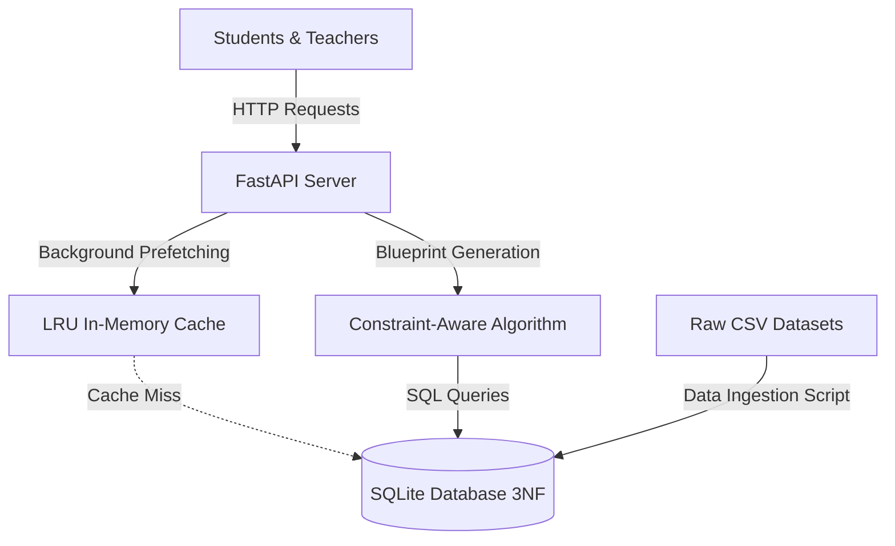

# Adaptive Paper Engine for eXaminations (APEX)

An OS-Optimized Institutional Assessment and Dynamic Question Bank Generator. This is a combined Project-Based Learning (PBL) project for Operating Systems and Database Management Systems.

## Project Overview
Current institutional examination systems rely on static question papers that fail to adapt to individual student learning curves during live assessments. For offline exams, teachers face significant manual overhead maintaining balanced difficulty distributions and filtering questions by specific textbook sources.

**APEX** solves this by providing a dual-layer architecture:
1. **Live Adaptive Testing Engine:** A highly concurrent server that uses OS-level predictive prefetching and LRU memory caching to deliver dynamic questions with sub-second latency.
2. **Offline Exam Paper Generator:** A constraint-aware matching algorithm that queries a normalized (3NF) relational database to instantly generate perfectly balanced exam papers based on teacher-defined blueprints.

## System Architecture



## Project Structure

```text
APEX/
├── db/                   # questions_bank.csv raw seed dataset
├── frontend/             # Single-page client UI (HTML5, Vanilla CSS/JS)
│   ├── index.html        # Unified student & teacher application
│   ├── style.css         # Modern, responsive stylesheet
│   ├── ui-logic.js       # Dynamic client controller & session lifecycle
│   └── api.js            # Unified REST client module
├── scripts/
│   └── import_csv.py     # Data Ingestion & SQL Transaction script
├── src/
│   ├── main.py           # Core FastAPI Server & REST endpoints
│   ├── database.py       # SQLite connection (WAL mode) & schema migration
│   ├── cache.py          # LRU Memory Cache implementation
│   ├── paper_engine.py   # Constraint-based Blueprint question generator
│   └── blueprint.py      # University paper layout generator
├── tests/                # Test suite (cache, paper engine)
├── start.bat             # One-click launcher script
└── requirements.txt      # Core Python dependencies
```

## Quickstart & Local Setup

1. **Install Dependencies:**
   ```bash
   pip install -r requirements.txt
   ```

2. **Launch Application:**
   - On Windows: Run `start.bat`
   - Alternatively:
     ```bash
     python -m uvicorn src.main:app --host 127.0.0.1 --port 8000 --reload
     ```

3. **Access Interface:**
   - Open browser at `http://127.0.0.1:8000/ui`

## Team Info

**Team Lead:** Khushi Sharma
**Team Members:** Roma Yadav, Rohit Sharma, Alok Goyal
